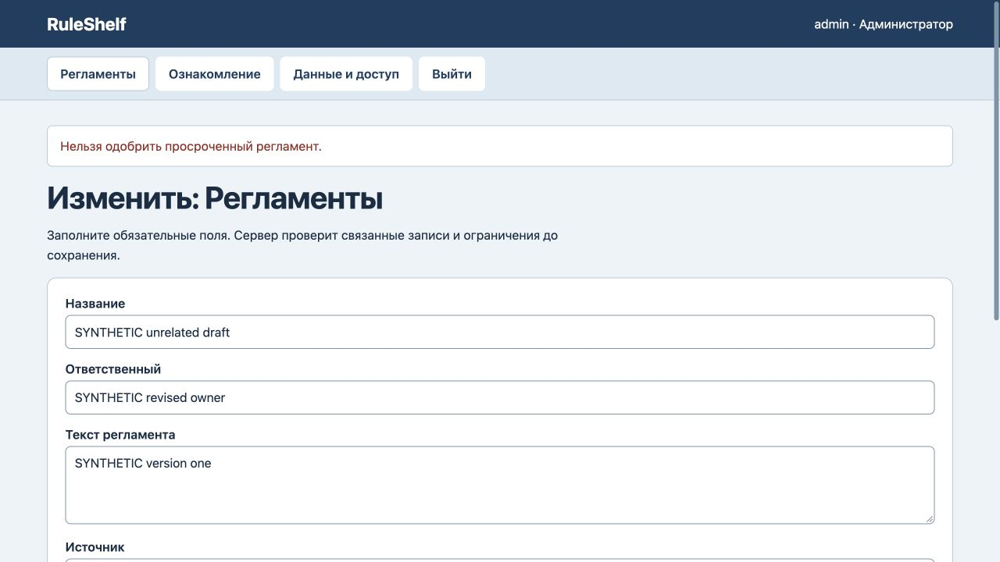
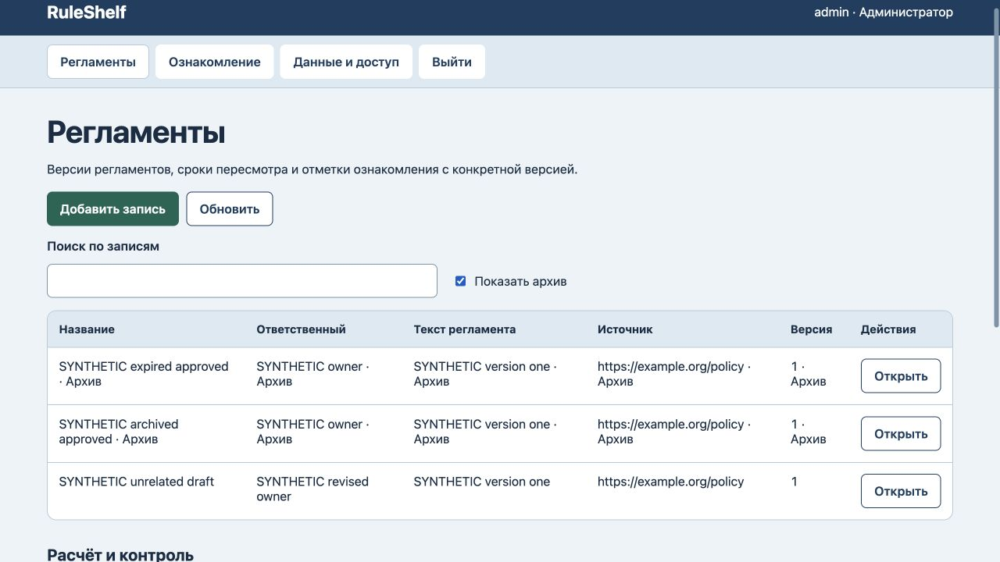
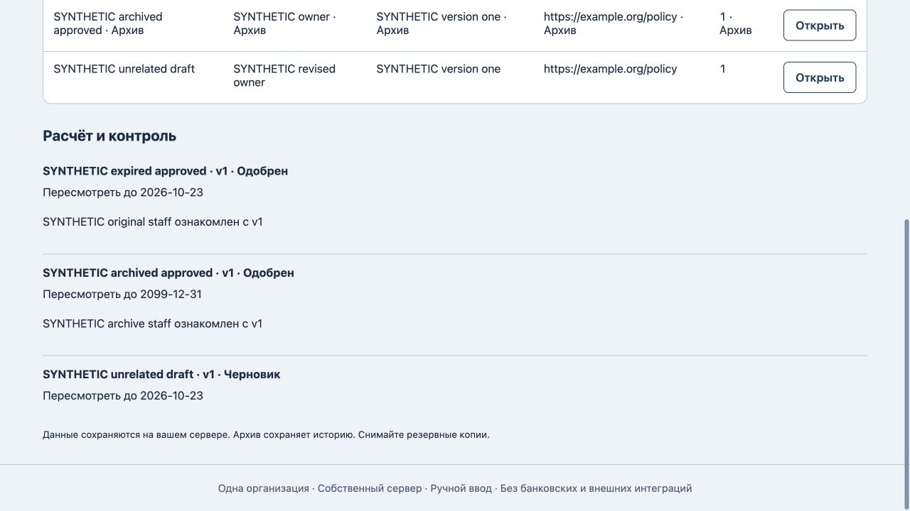

# RuleShelf: срок регламента и история ознакомлений

25 октября 2026. На прежнем коде воспроизведены два сбоя: истёкший срок одобренного регламента блокировал несвязанные правки и восстановление копии; архивный регламент допускал новые отметки ознакомления. Все три новые регрессии сначала завершились ошибкой.

Теперь срок по UTC проверяется при новом одобрении. История не блокирует другую работу, архив и восстановление. Новая отметка требует действующего неархивного одобренного регламента и его текущей версии. Существующие отметки неизменны: отметка v1 остаётся v1 после явного создания и одобрения v2. Исторический статус «Одобрен» не подтверждает актуальность содержания.

Прошли 7 тестов, включая переход даты, файловый перезапуск и восстановление в пустую базу. Браузерный отказ новой просроченной отметки сохранил все данные, две прежние отметки, версию 8 и 8 событий журнала. Архивный регламент отсутствует в выборе новой отметки; прямой авторизованный HTTP-запрос для него вернул 400 без изменения данных и журнала.

Независимый черновик сохранился, новая просроченная попытка одобрения отклонена: статус черновика, версия 9 и журнал 9 сохранены. Архивирование старого регламента сохранило исходные текст, источник, версию, срок, статус и обе прежние отметки; версия 10, журнал 10. История прочитана через «Показать архив». [Машинная проверка](lifecycle-verification.json).

Проверка выполнена локально на синтетических данных. Отметка не является электронной подписью или юридическим согласием. Прежние ошибочные отметки автоматически не исправляются. Разметка и схема хранения не менялись; новый полный аудит интерфейса или безопасности не проводился.
